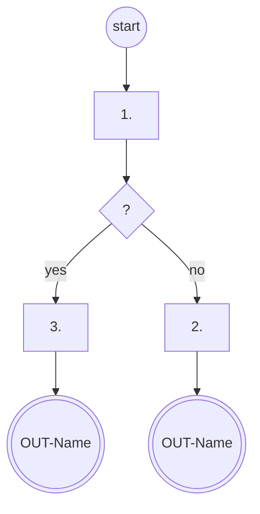

# <Agent display name>: procedures

## Primary execution paths

<!-- One subsection per primary execution path: a subagent, a router branch, or, for a
single-loop agent, the strategy prescribed by the prompt. Steps are numbered from 1 in each
procedure; the last step is the agent's final answer. -->

### P-<Name>: <display name>

Goal: <one sentence>.

Trigger: <when this path runs>.

1. <Action>. Calls `T-<Code>`. if <condition> -> go to step 3, else -> continue.
2. <Action>. -> finish with `OUT-<Name>`.
3. <Final answer>. -> finish with `OUT-<Name>`.

## Failure handling

<!-- Tool errors only: which errors the agent is expected to recover from and how. -->

- <tool code>: <error> -> <expected reaction>
