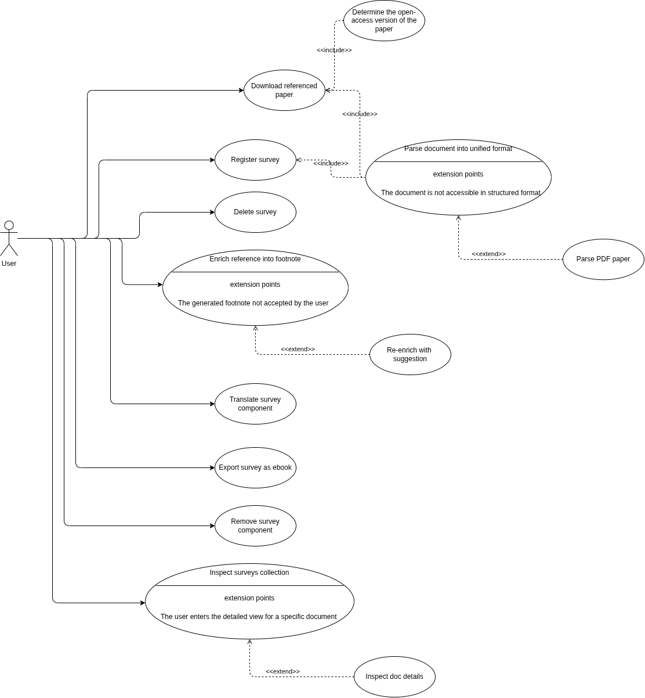
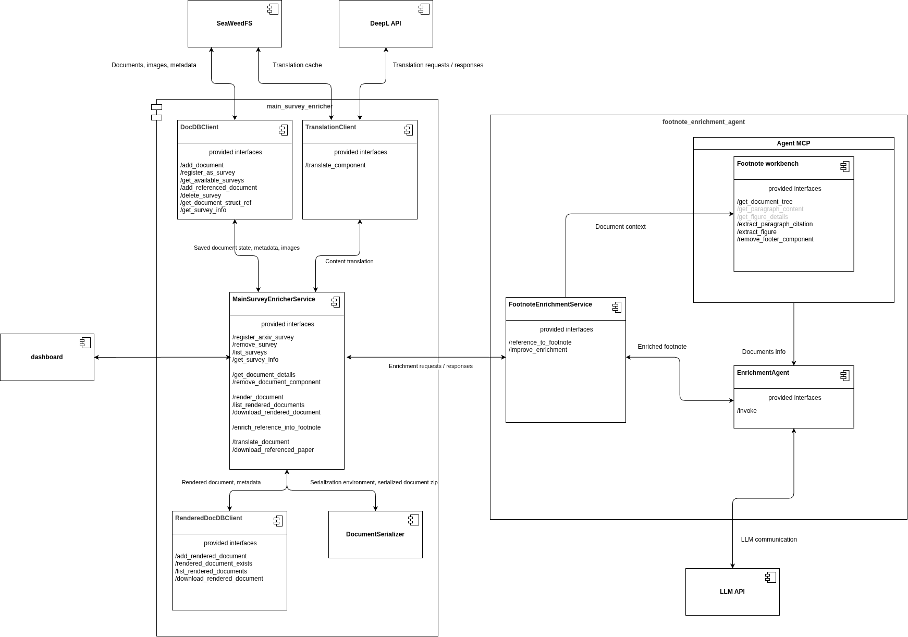
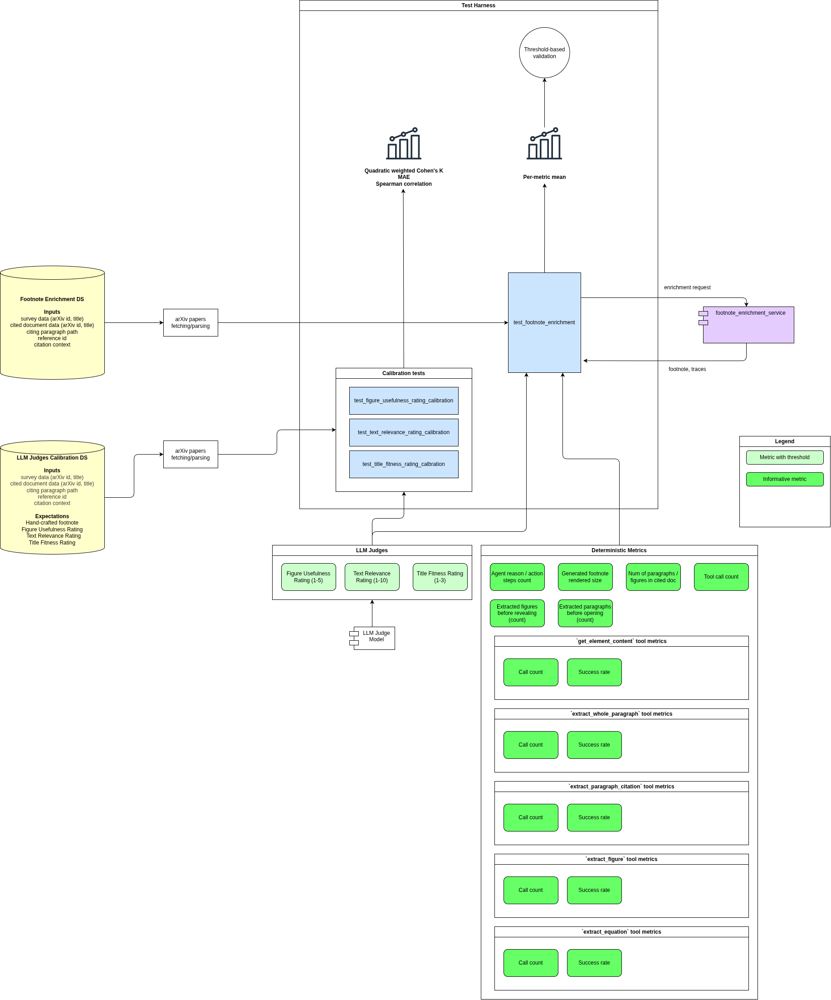

# paper-enrichment-agent

Paper Enrichment Agent is a tool designed to convert arXiv survey papers into full-fledged textbooks. Consider the following problem:

You want to read up on a chosen topic, such as "Paragraph Text-to-Speech synthesis", and you find a relevant survey paper on arXiv. However, most paragraphs take the form:

```
... Multiple works attempt to address the problem of lack of high quality paragraph data [1, 2, 3, 4]. In [5], the authors use context-extrapolation and generative context-enrichment techniques to train on single-sentence data. The authors of [6] build a single-sentence model, conditioned on GST-based [7] and BERT-based [8] embeddings, that leverages a mixture attention mask.
```

You realize that you are unlikely to grasp the topic fully without additional context, background information, and examples. This is where Paper Enrichment Agent comes in:

- The paper is parsed and converted into ebook format that is more reader-friendly and easier to navigate using a kindle-like device
- Each reference to a paper is automatically expanded into a context-aware citation that provides relevant quotes, figures and tables from the cited paper
- Each processed reference paper is effectively converted into a set of footnotes, which explain the context of the citation and provide additional background information

## Architecture

### Use case diagram



### Component / Data flow diagram



### Backend infrastructure

The whole backend runs in Docker and is defined in the [infrastructure/](infrastructure/) folder.
All the services are built from a single image and started with `docker compose`, wrapped in
`just` recipes (see the [justfile](justfile)):

- [app-base.Dockerfile](infrastructure/app-base.Dockerfile): multi-stage image shared by all the
  Python services. The `runtime` stage (`app-base:runtime`) contains the sources only and is used by
  the backend. The `eval` stage (`app-base:eval`) adds the tests and dev dependencies and is used by
  the unit tests and the LLM evaluation.
- [mlflow-server.yaml](infrastructure/mlflow-server.yaml): MLflow tracking server (traces and
  evaluation results) with its Postgres backend. It also creates the Docker network
  `paper-enrichment-agent-network`, which the other stacks join, so it must be started first
  (`just setup_mlflow_server`).
- [app-backend.yaml](infrastructure/app-backend.yaml): the application services and their
  observability stack (`just setup_app_backend`, `just teardown_app_backend`,
  `just setup_app_backend_clean`). The comments in the file describe each service in detail.
- [llm-eval.yaml](infrastructure/llm-eval.yaml): fresh instances of the evaluated services and the
  evaluation runner (`just run_llm_eval`).
- [unit-tests.yaml](infrastructure/unit-tests.yaml): dockerized unit tests with the coverage report
  (`just run_unit_tests`). The results land in `test_results/`.
- [observability/](infrastructure/observability/): configuration of Alloy, Loki and Prometheus,
  plus the provisioned Grafana datasources and dashboards.

The secrets are passed through gitignored env files placed in the repository root: `mlflow.env`,
`app.env` and `llm-eval.env`.

The services started by `just setup_app_backend`:

| Service | Role | Host port |
| --- | --- | --- |
| `main-survey-enricher` | Serves the user-facing API. | 8082 |
| `footnote-enrichment-agent` | Composes footnotes from the cited papers. | - |
| `paper-scraping-service` | Fetches and parses scientific papers. | - |
| `s3-database` | Stores the documents (`document-database` bucket) and their rendered archives (`rendered-documents` bucket). The filer UI at `localhost:8888/buckets/` lets you browse them. | 8888 (localhost only) |
| `alloy` | Ships the services' logs to Loki. | - |
| `loki` | Stores the logs. | 3100 |
| `prometheus` | Collects and stores the services' metrics. | 9090 |
| `grafana` | Displays the dashboards. | 3000 |

## Project structure

A single installable package, `src/paper_enrichment_agent`, holds several services. Each service
runs as its own process and container, and the services talk to each other over HTTP.

```
src/paper_enrichment_agent/
├── common/                         # Code shared by all services (no service-specific logic)
│   ├── models/
│   │   ├── document.py             # Document tree: Document, Section, Paragraph, Figure, ImgSubfigure,
│   │   │                           #   TableSubfigure, List, MathExpression, Reference
│   │   ├── misc.py                 # DocumentMetadata, SurveyMetadata (DB-level metadata),
│   │   │                           #   PaperMetadata (DOI, authors, publication date),
│   │   │                           #   PaperAccessType, PaperAccessInfo (paper access agent answer)
│   │   └── service_conn.py         # HTTP API request/response bodies shared by services & eval harness
│   ├── document_manipulators.py    # DocumentGetter / DocumentSetter: path-based tree traversal & edits
│   ├── mcp_agent_utils.py          # Shared by the agents: MCP tools -> LLM functions, traced tool calls
│   ├── http_client.py              # Async HTTPClient (httpx): JSON / multipart POST, propagates
│   │                               #   MLflow trace context
│   ├── logging_setup.py            # structlog setup: colored console + rotating JSONL file
│   └── mlflow_setup.py             # MLflow tracing setup (litellm autolog)
├── main_survey_enricher/           # User-facing API service (port 8082)
│   ├── cfg/main.yaml               # Hydra config (mapped onto AppCfg in main.py)
│   ├── main.py                     # Entrypoint: AppCfg, create_app() (FastAPI routes), @hydra.main
│   ├── service.py                  # MainSurveyEnricherService (business logic) + Metrics
│   └── components/
│       ├── db_clients/
│       │   ├── core.py             # DBClientException, DBClient (Protocol: async object store +
│       │   │                       #   pydantic helpers), S3DBClient (S3 implementation)
│       │   ├── doc_db_client.py    # DocDBClient: document DB layout (metadata, documents, images)
│       │   │                       #   on top of an injected DBClient
│       │   └── rendered_doc_db_client.py  # RenderedDocDBClient: stores / lists / downloads the
│       │                           #   serialized (rendered) document archives
│       └── doc_serializers/
│           ├── core.py             # SerializationEnvironment (work dir, image paths, archive path)
│           └── markdown.py         # MarkdownSerializer: Document -> paper.md + images -> zip
├── paper_scraping_service/         # Internal paper download & parsing service (port 8083, not exposed)
│   ├── cfg/main.yaml
│   ├── main.py                     # Entrypoint: AppCfg, create_app() (POST /parse_arxiv_paper,
│   │                               #   POST /download_pdf_paper (multipart),
│   │                               #   POST /resolve_paper_access,
│   │                               #   POST /parse_paper_from_citation_signature)
│   ├── service.py                  # PaperScrapingService + Metrics
│   └── components/
│       ├── fetchers.py             # ArxivMetadataFetcher: arXiv export API -> PaperMetadata,
│       │                           #   ar5iv HTML / arXiv PDF availability checks;
│       │                           #   OpenAlexScraper, UnpaywallFetcher, CrossrefFetcher
│       ├── paper_access_agent.py   # PaperAccessAgent: LangGraph ReAct loop resolving a citation
│       │                           #   signature into PaperAccessInfo (arxiv ID / PDF URL + metadata)
│       ├── paper_access_tools.py   # PaperAccessTools: agent tools delegating to the fetchers,
│       │                           #   exposed as an in-memory MCP server
│       ├── prompt_templates/*.md   # System/user prompt templates of the paper access agent
│       └── parsers/
│           ├── arxiv_parser.py     # ArxivParser: ar5iv HTML -> Document
│           └── pdf_parser.py       # PdfParser: PDF URL / PDF bytes -> marker API JSON -> Document
└── footnote_enrichment_agent/      # Internal LLM agent service (port 8081, not exposed)
    ├── cfg/main.yaml
    ├── main.py                     # Entrypoint: AppCfg, create_app(), per-session MCP route dispatch
    ├── service.py                  # FootnoteEnrichmentAgentService + Metrics
    └── components/
        ├── agent.py                # FootnoteEnrichmentAgent: LangGraph ReAct loop, MCP client, MLflow spans
        ├── enrichment_tools.py     # EnrichmentTools: per-session tool state exposed to the agent via MCP
        ├── enrichment_context_manager.py  # Creates/tears down a FastMCP app per agent session
        ├── doc_utils.py            # Paragraph/figure/equation rendering for the agent
        └── prompt_templates/*.md   # System/user prompt templates (LangChain template files)

tests/
├── unit/                           # pytest unit tests, mirroring the layout of src/paper_enrichment_agent
└── llm_eval/                       # MLflow-based LLM evaluation (see "Evaluation" below)

infrastructure/                     # Dockerfile, compose stacks and observability config
docs/                               # Architecture and evaluation diagrams (draw.io PNGs)
.devcontainer/                      # Dev environment (Ubuntu, just, uv, docker-in-docker)
justfile                            # All the development and deployment workflows
```

## Evaluation

### Footnote Enrichment Agent



### Eval setup

The evaluation is based on `mlflow` and its `pytest` plugin. The module hierarchy of the evaluation code is shown below:

```yaml
tests/llm_eval:
    # Per-test-suite setup, including the definition of data samples, test cases and scorers.
    suites:
        test_footnote_enrichment:
            # Suite-specific setup - defines at least the experiment name.
            conftest.py
            #
            data.py
            # Defines particular evaluators of the traces produced for each data sample.
            # This is the place where the LLM Judges should be placed as well.
            scorers.py
            # Defines the test cases - including the Judge LLM calibration.
            test_footnote_enrichment.py
        ...
# Configuration of the entire evaluation pipeline - should contain per-suite configuration and global config, such as MLFlow
# server URI, Judge LLM parameters etc.
cfg.yaml
# Global evaluation setup - the module docstring defines how each test suite should be structured.
conftest.py
# Core evaluation utilities.
core.py
# Entrypoint script that loads config and runs evaluation.
run_eval.py
```

A single suite is supposed to correspond with a single MLFlow experiment. A single process run is meant to correspond with a single MLFlow run, therefore only one suite is allowed to be run at once.

## Changelog

The changes are provided in the [CHANGELOG.md](CHANGELOG.md) file.
