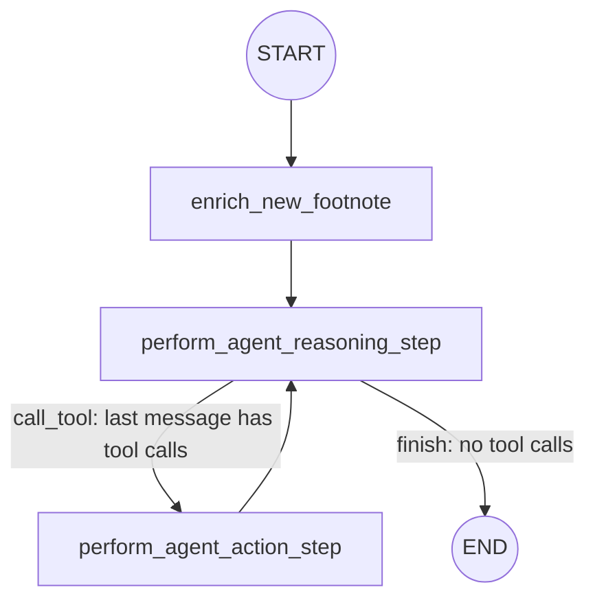

# Footnote Enrichment Agent: core

Composes a footnote that explains a single citation of a survey, out of excerpts (paragraphs,
citation fragments, figures, equations) of the cited document, and writes a prelude introducing
it.

## Agent architecture

A ReAct agent: an entry node builds the task from the request, then a single reason + act loop
calls the enrichment tools until the LLM answers without calling a tool.

| Node | MLflow span | Role | Prompt parts added |
| --- | --- | --- | --- |
| (graph root) | `FootnoteEnrichmentAgent::invoke` | The whole invocation, traced under the request's session id. | - |
| `enrich_new_footnote` | `enrich_new_footnote` | Locates the citation in the referencing paragraph, cuts out its context and renders the tree of contents of the cited document. | `footnote_enrichment_system_prompt`, `footnote_enrichment_user_prompt` |
| `perform_agent_reasoning_step` | `agent_reasoning` | Invokes the LLM with the enrichment tools bound. | The LLM's message: reasoning, tool calls or the prelude |
| `perform_agent_action_step` | `agent_action` | Executes the tool calls of the last LLM message, each in a `call_tool <name>` span. | One tool result (or tool error) per tool call |

| Template | Message role | Shows to the agent |
| --- | --- | --- |
| `footnote_enrichment_system_prompt` | system | The goal (turning a survey into a textbook), the task (a footnote explaining one citation), the document component types, the path-based navigation in the cited document, the guidelines (extract only content relevant to the citation context, gather context first, extractions are permanent, do not invent paths), and the survey's title and abstract. |
| `footnote_enrichment_user_prompt` | user | The cited document's title, abstract and tree of contents, the citation marker and the survey fragment around it, where in the survey the citation occurs, and the instruction to finish with a prelude only. |

### Configuration

| Parameter | Influence on the execution |
| --- | --- |
| `citation_context_chars` | How many characters of the referencing paragraph around the citation the agent sees (half before, half after). Less context makes it harder to judge which part of the cited document the survey talks about. |
| `drop_sections_from_level` | The depth of the cited document's section hierarchy reproduced in the footnote. Components from deeper sections are grouped in their closest reproduced ancestor; `1` gives a flat footnote. |
| `min_citation_match_threshold` | The fraction of a citation anchor that must match the paragraph text for `T-Extract-Paragraph-Citation` to accept it. Lower values tolerate more mistakes in the copied anchors. |

## Important info

- **The footnote is the tools' state, not the LLM's answer.** The agent builds the footnote only
  by calling the extraction tools; the footnote is generated from the extracted components after
  the agent finishes. The agent's own answer is the prelude of the footnote.
- **Extractions cannot be undone.** There is no tool removing or reordering an extracted
  component, so the agent must read an element before extracting it.
- **The order of extraction does not matter.** The footnote orders the extracted components by
  their positions in the cited document and reproduces their source sections (up to
  `drop_sections_from_level`), so the agent may extract in any order.
- **The agent never sees the whole cited document.** It gets the tree of contents (ids, types,
  paths, section titles and figure captions, no paragraph text) and reads the elements one by
  one, so it must choose what to read.
- **The footnote is limited to the citation context.** It explains what the survey says about
  the cited document, not the cited document as a whole: a detailed citation calls for the
  described parts, a group citation for a brief description of the methodology.
- **Running out of steps still yields a footnote.** When the step limit is hit, the footnote
  contains whatever was extracted so far (possibly nothing, untitled) and the prelude is replaced
  by a fixed message; it is not reported as an error.

## Changelog

| Date | Merge commit | Changes |
| --- | --- | --- |
| unreleased | - | Initial version: ReAct agent composing a footnote with the `get_element_content`, `extract_paragraph_citation`, `extract_whole_paragraph`, `extract_figure`, `extract_equation` and `set_footnote_title` tools. Fuzzy matching of citation anchors. Footnote ordered by the source positions of the extracted components, with the source sections reproduced up to `drop_sections_from_level`. Final answer limited to the prelude of the footnote. |
