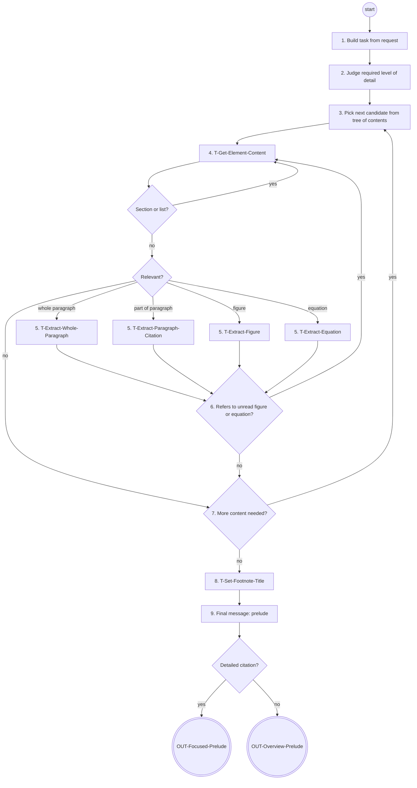

# Footnote Enrichment Agent: procedures

## Primary execution paths

The agent has a single execution path: the reason + act loop follows the strategy given in the
system prompt. The order of reading and extracting is up to the LLM; the steps below are the
prescribed one.

### P-Compose-Footnote: Compose a footnote for a citation

Goal: fill the enrichment state with the excerpts of the cited document that explain the
citation in its survey context, then give the footnote a title and a prelude.

Trigger: every footnote enrichment request.

1. Build the task (`enrich_new_footnote` node): locate the citation by `reference_id`, cut its
   context out of the referencing paragraph, render the tree of contents of the cited document
   and present them in the prompts.
2. Judge from the citation context and the survey abstract how detailed the footnote must be:
   `IN-Detailed-Citation` calls for the described parts and their figures, `IN-Group-Citation`
   for a brief description of the methodology.
3. Pick the next candidate element from the tree of contents: first the abstract-like parts and
   the last paragraphs of the introduction, then the sections matching the citation context.
4. Read the candidate with `T-Get-Element-Content`. if the element is a section or a list -> pick
   a readable element it contains and repeat step 4.
5. Decide on the read element:
   - if it is irrelevant -> go to step 7;
   - if it is a paragraph relevant as a whole -> `T-Extract-Whole-Paragraph`;
   - if only a part of a paragraph is relevant -> `T-Extract-Paragraph-Citation` with anchors
     copied verbatim from the read content;
   - if it is a relevant figure -> `T-Extract-Figure`, with `subfigures_ids` when only some
     subfigures are relevant;
   - if it is a relevant standalone equation -> `T-Extract-Equation`.
6. if the extracted text refers to a figure or an equation that has not been read yet (e.g. "as
   shown in Figure 3") -> make it the next candidate and go to step 4.
7. if the footnote does not yet explain the cited content to the required level of detail -> go
   to step 3, else -> continue.
8. Set the footnote title with `T-Set-Footnote-Title`.
9. Answer with the prelude only, without tool calls -> finish with `OUT-Focused-Prelude` or
   `OUT-Overview-Prelude`, depending on the level of detail judged in step 2.

## Failure handling

The agent is expected to recover from every tool error by correcting the call:

- **Unknown path** (any tool): look the element up again in the tree of contents and retry with a
  path made of component ids only, without whitespace or extra segments.
- **Unreadable element** (`T-Get-Element-Content` on a section or a list): read the elements it
  contains instead.
- **Wrong element type** (`T-Extract-*` on an element of another type): use the extraction tool
  matching the element's type.
- **Anchor not found** (`T-Extract-Paragraph-Citation`): copy the anchors again verbatim from the
  read content, using the matched part and the closest text given in the error message.
- **Unknown subfigure ids** (`T-Extract-Figure`): retry with the existing ids listed in the error
  message.
