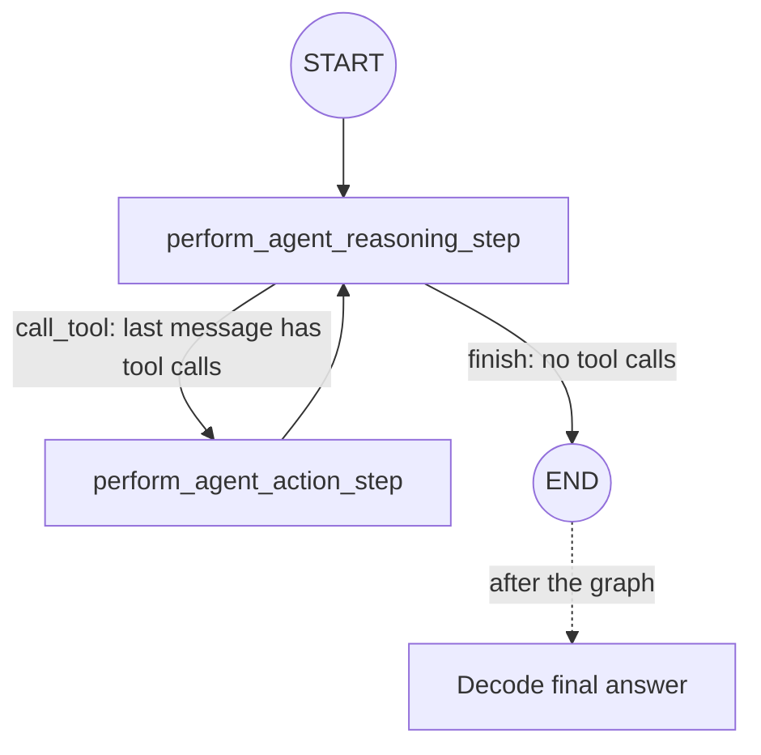

# Paper Access Agent: core

Identifies the paper described by a citation signature and finds its best publicly available
source (an arXiv HTML version or an open access PDF), together with its bibliographic metadata.
The agent does not download the paper.

## Agent architecture

A ReAct agent: a single reason + act loop over four lookup tools. The final message is decoded
into a `PaperAccessInfo` or `null`.

| Node | MLflow span | Role | Prompt parts added |
| --- | --- | --- | --- |
| (graph root) | `PaperAccessAgent::invoke` | The whole invocation, including the answer decoding. | `paper_access_system_prompt`, `paper_access_user_prompt` (formatted before the first step) |
| `perform_agent_reasoning_step` | `agent_reasoning` | Invokes the LLM with the tools bound. | The LLM's message: reasoning, tool calls or the final answer |
| `perform_agent_action_step` | `agent_action` | Executes the tool calls of the last LLM message, each in a `call_tool <name>` span. | One tool result (or tool error) per tool call |

| Template | Message role | Shows to the agent |
| --- | --- | --- |
| `paper_access_system_prompt` | system | The role (research librarian), the task (metadata + best public source), the two source types and the preference of `arxiv` over `pdf`, the step-by-step strategy, the guidelines (single search, no guessed identifiers, few tool calls), and the output format with the JSON schema of `PaperAccessInfo`, an example and the `null` answer. |
| `paper_access_user_prompt` | user | The citation signature to resolve. |

### Configuration

| Parameter | Influence on the execution |
| --- | --- |
| `openalex_max_results` | How many OpenAlex works `T-Search-OpenAlex` returns. Since the agent searches only once, a matching work ranked lower is never seen. |

## Important info

- **The answer is the decoded final message.** It must be exactly a JSON `PaperAccessInfo` or
  `null`; any other text fails the invocation.
- **`null` is a valid answer.** It means that the paper could not be identified or has no public
  version, and is distinct from a failure.
- **The sources have a strict preference order**: arXiv HTML, then arXiv PDF, then an Unpaywall
  PDF. A lower source is used only when the higher ones do not exist.
- **The paper is identified by a single search.** The agent searches OpenAlex once, by the title
  derived from the signature, and gives up if no returned work matches.
- **The metadata must be complete.** The answer requires a DOI and a publication date, both taken
  from the matched OpenAlex work; the DOI of the published version is preferred over the arXiv
  DOI.
- **Each resolution is independent.** The agent keeps no memory between invocations, and the
  tools share no state.

## Changelog

| Date | Merge commit | Changes |
| --- | --- | --- |
| unreleased | - | Initial version: ReAct agent resolving a citation signature with the `scrape_metadata_from_openalex`, `has_arxiv_html_version`, `is_arxiv_pdf_location_correct` and `query_unpaywall` tools. Single OpenAlex search, no retries. Source preference: arXiv HTML, arXiv PDF, Unpaywall PDF. |
