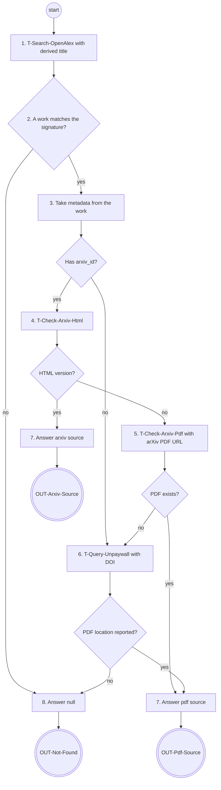

# Paper Access Agent: procedures

## Primary execution paths

The agent has a single execution path: the reason + act loop follows the strategy given in the
system prompt, which is a fixed decision chain over the source preference order (arXiv HTML >
arXiv PDF > Unpaywall PDF).

### P-Resolve-Paper-Access: Resolve a citation signature into a public source

Goal: identify the cited paper and answer with its best public source and metadata, or `null`.

Trigger: every paper access resolution request.

1. Derive the full title from the citation signature and search for it once with
   `T-Search-OpenAlex`.
2. Pick the work whose title, authors and year match the signature. if none matches -> go to
   step 8.
3. Take the metadata from the matched work: the DOI of the published version if reported, else the
   arXiv DOI `10.48550/arXiv.<id>`; full author names in order; the publication date. if the work
   has no `arxiv_id` -> go to step 6, else -> continue.
4. Check `T-Check-Arxiv-Html` with the `arxiv_id`. if `true` -> go to step 7 with the `arxiv`
   source (the arXiv ID).
5. Build `https://arxiv.org/pdf/<arxiv_id>` and check it with `T-Check-Arxiv-Pdf`. if `true` -> go
   to step 7 with the `pdf` source (this URL).
6. Query `T-Query-Unpaywall` with the DOI. if it reports a PDF -> go to step 7 with the `pdf`
   source: `best_pdf_url`, else the first published, then accepted, then submitted
   `pdf_locations` entry; else -> go to step 8.
7. Answer with the JSON of the source and the metadata -> finish with `OUT-Arxiv-Source` or
   `OUT-Pdf-Source`.
8. Answer `null` -> finish with `OUT-Not-Found`.

## Failure handling

The agent does not retry a failed lookup with modified arguments; it moves on along the chain:

- **OpenAlex search fails** (`T-Search-OpenAlex`, e.g. the service is unreachable): the paper
  cannot be identified -> answer `null`.
- **Invalid or unknown arXiv ID** (`T-Check-Arxiv-Html`): treat the work as not available on
  arXiv -> query Unpaywall with the DOI.
- **Malformed arXiv PDF URL** (`T-Check-Arxiv-Pdf`): rebuild the URL in the
  `https://arxiv.org/pdf/<arxiv_id>` form and retry once; if arXiv is unreachable -> query
  Unpaywall.
- **Unknown DOI** (`T-Query-Unpaywall`): no public PDF can be found -> answer `null`.
